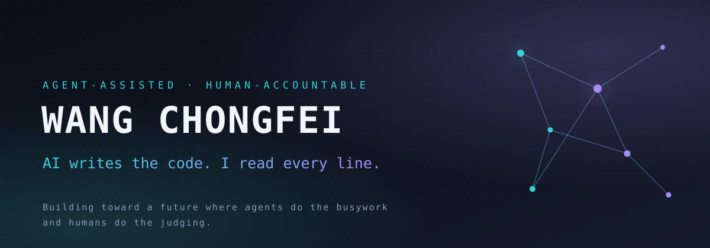

  

  

  
  
  
  

 

Software engineer. This README documents how this account works, so that
maintainers and reviewers know exactly what to expect from my pull requests.

## ⚙️ How contributions here are made

I work with AI coding agents (agent-assisted workflow). The division of labor:

1. **🧭 I** choose the problem, the repository, and the scope.
2. **🤖 The agent** investigates the codebase, reads issues and docs, implements a
   candidate fix, and runs the test suite.
3. **👀 I** review every line of the resulting diff, reproduce the verification
   myself, and only then open the PR.
4. **✍️ I** take full responsibility for everything submitted under this account.

The agent never opens, updates, or merges a PR on its own. Every submission
passes through my review first.

## 🧱 Operating principles

<table>
<tr>
<td width="33%" valign="top">

**👤 Human accountable**

I can explain what every change does and how it interacts with the rest of the
system, without asking the AI.

</td>
<td width="33%" valign="top">

**📣 Disclosure**

Every PR states that it was prepared with AI assistance, naming the tool.

</td>
<td width="33%" valign="top">

**🧩 Small & reviewable**

Small diffs, one problem per PR, tests included, low cadence.

</td>
</tr>
<tr>
<td width="33%" valign="top">

**📜 Respect upstream rules**

Contribution guides, issue-first workflows, CLA/DCO — checked before code.

</td>
<td width="33%" valign="top">

**🚫 No benchmark gaming**

Evaluation harnesses are never modified; results only via official channels.

</td>
<td width="33%" valign="top">

**🤐 No marketing**

PRs carry no product or brand promotion.

</td>
</tr>
</table>

<!-- merged-prs:start -->
## 📊 Merged open-source contributions

**33** merged pull requests in other people's repositories, across **2** open-source projects. From 2026-07-27 to 2026-11-06.

Every one of them was reviewed line by line before submission, discloses its AI assistance in the body, and is my responsibility.

### Upstream repositories

**[Tencent/teamai-cli](https://github.com/Tencent/teamai-cli)**

| PR | What | Size | Merged |
|---|---|---|---|
| [#1759](https://github.com/Tencent/teamai-cli/pull/1759) | fix(push): give every push branch a name nothing has yet | +26/-8 | 2026-11-06 |
| [#1756](https://github.com/Tencent/teamai-cli/pull/1756) | fix(dashboard): give the benchmark Recall column its zh-CN label | +1/-0 | 2026-11-06 |
| [#1740](https://github.com/Tencent/teamai-cli/pull/1740) | fix(benchmark): keep an arm's recall when a record is read back | +79/-5 | 2026-11-06 |
| [#1729](https://github.com/Tencent/teamai-cli/pull/1729) | test(relations): cover a learning that lives in the learnings worktree | +78/-1 | 2026-11-05 |
| [#1728](https://github.com/Tencent/teamai-cli/pull/1728) | feat(benchmark): give an arm a clone that deploys the team's recall | +175/-17 | 2026-11-05 |
| [#1727](https://github.com/Tencent/teamai-cli/pull/1727) | fix(tool-launch): give a confined Codex judge the member's CODEX_API_KEY | +204/-1 | 2026-11-05 |
| [#1726](https://github.com/Tencent/teamai-cli/pull/1726) | fix(update): report an interrupted install as interrupted, not as a failure | +92/-6 | 2026-11-05 |
| [#1695](https://github.com/Tencent/teamai-cli/pull/1695) | feat(shared-instructions): accept `agentsmd/` as a shared-instruction source directory | +473/-49 | 2026-11-04 |
| [#1679](https://github.com/Tencent/teamai-cli/pull/1679) | test(sessions): cover reading Qoder and Qoder CN transcripts (#1418) | +144/-0 | 2026-11-03 |
| [#1637](https://github.com/Tencent/teamai-cli/pull/1637) | feat(lint,viz,stats): see asset relations — lint counts, health view, opens via relation (#1562, stacked) | +1613/-116 | 2026-11-02 |
| [#1636](https://github.com/Tencent/teamai-cli/pull/1636) | feat(relations): derived rule-path edges and reconcile candidates (#1563) | +676/-19 | 2026-11-02 |
| [#1629](https://github.com/Tencent/teamai-cli/pull/1629) | feat(recall): declared asset relations on recall hits, checked by review --branch (#1552 first slice) | +1612/-210 | 2026-10-31 |
| [#1628](https://github.com/Tencent/teamai-cli/pull/1628) | feat(recall): record query text in the session recall-quality cache | +60/-5 | 2026-10-31 |
| [#1555](https://github.com/Tencent/teamai-cli/pull/1555) | rank(search): ignore question words and normalize the title field | +268/-36 | 2026-10-30 |
| [#1549](https://github.com/Tencent/teamai-cli/pull/1549) | rank(recall): prefer the codebase page the query names, and keep the top 3 source-diverse | +299/-3 | 2026-10-29 |
| [#1547](https://github.com/Tencent/teamai-cli/pull/1547) | fix(hooks): record what a CodeBuddy session does, and what it loads | +289/-42 | 2026-10-29 |
| [#1542](https://github.com/Tencent/teamai-cli/pull/1542) | fix(workflow): a stop of an attempt reaches the setup's process group | +89/-17 | 2026-10-29 |
| [#1524](https://github.com/Tencent/teamai-cli/pull/1524) | fix(recall): rank an explicit docs match above a saturated codebase hit | +248/-17 | 2026-10-29 |
| [#1522](https://github.com/Tencent/teamai-cli/pull/1522) | test(workflow): give the eight flaky workflow cases a budget that fits their real work (#1504) | +8/-4 | 2026-10-28 |
| [#1521](https://github.com/Tencent/teamai-cli/pull/1521) | test(ci): forget a pid the runner cannot signal, and run the CodeBuddy gate on Windows (#1504) | +34/-3 | 2026-10-28 |
| [#1497](https://github.com/Tencent/teamai-cli/pull/1497) | feat(hooks): run project team hooks on OpenCode and OMP (#1492) | +729/-28 | 2026-10-28 |
| [#1465](https://github.com/Tencent/teamai-cli/pull/1465) | feat(worktree): one side-branch checkout per self-mode repo (#1443) | +610/-46 | 2026-10-28 |
| [#1445](https://github.com/Tencent/teamai-cli/pull/1445) | fix(worktree): evict a stale side-branch checkout from either scope (#1443) | +140/-11 | 2026-10-27 |
| [#1421](https://github.com/Tencent/teamai-cli/pull/1421) | fix(ci): read changes through the default branch and accept skin-tone rejections | +53/-6 | 2026-10-26 |
| [#1417](https://github.com/Tencent/teamai-cli/pull/1417) | fix(import): preserve curated docs and domain metadata across imports | +366/-2 | 2026-10-26 |
| [#1411](https://github.com/Tencent/teamai-cli/pull/1411) | fix(ci): preserve the instance scheme, paginate the MR lookup, address the project by path | +288/-257 | 2026-10-26 |
| [#1321](https://github.com/Tencent/teamai-cli/pull/1321) | feat(ci): support GitLab in ci extract-mr comments and rejection marks | +645/-24 | 2026-10-26 |
| [#321](https://github.com/Tencent/teamai-cli/pull/321) | test(providers/gitlab): add opt-in live smoke test against real GitLab | +22/-0 | 2026-08-25 |

**[first-tree-ai/first-tree](https://github.com/first-tree-ai/first-tree)**

| PR | What | Size | Merged |
|---|---|---|---|
| [#2430](https://github.com/first-tree-ai/first-tree/pull/2430) | test(server): stop the durable-ack fallback cases from racing their own window | +18/-6 | 2026-11-05 |
| [#2429](https://github.com/first-tree-ai/first-tree/pull/2429) | test(server): give the lost-wake provider-models test real timing headroom | +9/-4 | 2026-11-04 |
| [#2428](https://github.com/first-tree-ai/first-tree/pull/2428) | test(web): pin Intl default locale in schedules-section-dom assertions | +20/-0 | 2026-11-04 |
| [#2427](https://github.com/first-tree-ai/first-tree/pull/2427) | fix(server): send non-ASCII attachment names as RFC 5987 filename* | +31/-6 | 2026-11-04 |
| [#1975](https://github.com/first-tree-ai/first-tree/pull/1975) | fix(kimi-code): pass KIMI_CODE_HOME to harness for config/credential resolution | +237/-7 | 2026-07-27 |

<!-- merged-prs:end -->

## 🧰 Tooling

  

AI coding agents (Claude Code and similar), mainstream standard-compatible
model APIs, sandboxed execution for untrusted upstream code.

## 📬 Contact

Open an issue or discussion in the relevant repository — I read everything.

---

  中文版说明见 <a href="README.zh-CN.md">README.zh-CN.md</a>

