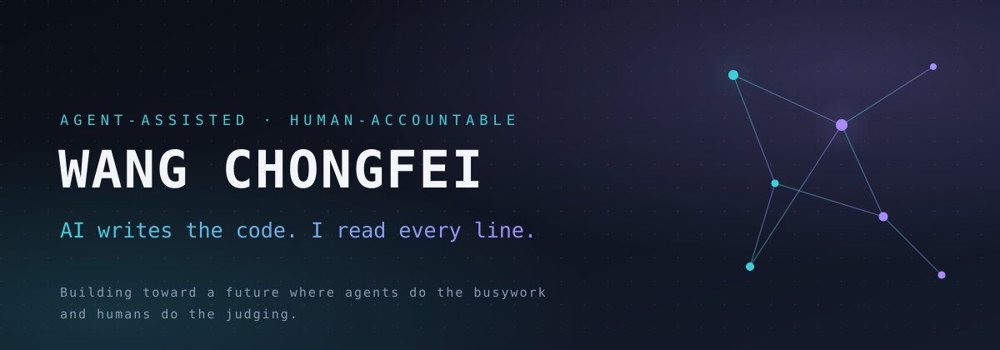

  

  

  
  
  
  

 

软件工程师。这个页面说明本账号的运作方式，让维护者和 reviewer 确切知道
我的 PR 是怎么来的、可以期待什么。

## ⚙️ 贡献是如何产生的

我使用 AI 编程助手（agent 辅助工作流），分工如下：

1. **🧭 我**选题、选仓库、定边界。
2. **🤖 Agent** 调研代码、读 issue 和文档、实现候选修复、跑测试。
3. **👀 我**逐行审阅产出的每一个 diff，亲自复现验证结果，然后才提 PR。
4. **✍️ 我对**本账号提交的所有内容承担全部责任。

Agent 不会自行创建、更新或合并 PR——每次提交都先经过我的审阅。

## 🧱 运营原则

<table>
<tr>
<td width="33%" valign="top">

**👤 责任在人**

不借助 AI 也能讲清每处改动的作用及其与系统其余部分的关系。

</td>
<td width="33%" valign="top">

**📣 披露**

每个 PR 都会声明使用了 AI 辅助并注明工具。

</td>
<td width="33%" valign="top">

**🧩 小而可审**

diff 小、一个 PR 只解决一个问题、附测试、低频提交。

</td>
</tr>
<tr>
<td width="33%" valign="top">

**📜 遵守上游规则**

CONTRIBUTING、issue-first 流程、CLA/DCO 要求，写代码之前先确认。

</td>
<td width="33%" valign="top">

**🚫 不碰评测器**

评测框架和 benchmark 永不修改；成绩只走官方提交渠道。

</td>
<td width="33%" valign="top">

**🤐 不做广告**

PR 中不带任何产品或品牌推广。

</td>
</tr>
</table>

<!-- merged-prs:start -->
## 📊 已合并的开源贡献

在别人的仓库里被合并的 PR 共 **77** 个，覆盖 **4** 个开源项目。时间跨度 2026-07-27 → 2026-11-19。

每个 PR 都经过人工逐行审阅后提交，正文披露 AI 参与，并由我对全部内容负责。

### 上游仓库

**[first-tree-ai/first-tree](https://github.com/first-tree-ai/first-tree)**

| PR | 内容 | 规模 | 合并 |
|---|---|---|---|
| [#2458](https://github.com/first-tree-ai/first-tree/pull/2458) | fix(server): treat an undecodable OAuth state cookie as absent | +30/-1 | 2026-11-17 |
| [#2455](https://github.com/first-tree-ai/first-tree/pull/2455) | feat(deepseek-harness): fall back to the DSH desktop credentials file for DEEPSEEK_API_KEY | +441/-2 | 2026-11-17 |
| [#2454](https://github.com/first-tree-ai/first-tree/pull/2454) | fix(client): boot the DeepSeek harness with a valid cordis template | +17/-1 | 2026-11-16 |
| [#2453](https://github.com/first-tree-ai/first-tree/pull/2453) | fix(client): follow same-origin redirects only on credentialed SDK calls | +272/-1 | 2026-11-16 |
| [#2452](https://github.com/first-tree-ai/first-tree/pull/2452) | fix(cli): refuse to send a saved token to a different server origin | +1110/-410 | 2026-11-19 |
| [#2451](https://github.com/first-tree-ai/first-tree/pull/2451) | fix(server): stop capturing credential-bearing config bodies, scrub nested strings | +364/-28 | 2026-11-17 |
| [#2450](https://github.com/first-tree-ai/first-tree/pull/2450) | fix(shared): redact OAuth callback params and invitation tokens in logged URLs | +217/-19 | 2026-11-17 |
| [#2448](https://github.com/first-tree-ai/first-tree/pull/2448) | fix(client): scrub Sentry events with the shared credential pass | +131/-6 | 2026-11-19 |
| [#2447](https://github.com/first-tree-ai/first-tree/pull/2447) | fix(client): keep TUI config temp files private and out of tmux errors | +270/-14 | 2026-11-17 |
| [#2446](https://github.com/first-tree-ai/first-tree/pull/2446) | fix(server): read doc previews from the descriptor that was checked | +796/-56 | 2026-11-18 |
| [#2445](https://github.com/first-tree-ai/first-tree/pull/2445) | feat(cli): accept agent env values from stdin | +169/-29 | 2026-11-15 |
| [#2443](https://github.com/first-tree-ai/first-tree/pull/2443) | fix(cli): strip terminal control bytes from interactive chat output | +154/-4 | 2026-11-15 |
| [#2442](https://github.com/first-tree-ai/first-tree/pull/2442) | fix(shared): require https for installer URLs | +274/-40 | 2026-11-15 |
| [#2441](https://github.com/first-tree-ai/first-tree/pull/2441) | fix(cli): single-quote launcher paths so $(...) stays inert | +242/-30 | 2026-11-15 |
| [#2440](https://github.com/first-tree-ai/first-tree/pull/2440) | fix(cli): reject agent names that escape the state roots on removal | +250/-6 | 2026-11-16 |
| [#2439](https://github.com/first-tree-ai/first-tree/pull/2439) | fix(installer): refuse to overwrite a shim this install does not own | +379/-12 | 2026-11-15 |
| [#2438](https://github.com/first-tree-ai/first-tree/pull/2438) | docs: add a Chinese companion to the contributor guide | +100/-1 | 2026-11-14 |
| [#2437](https://github.com/first-tree-ai/first-tree/pull/2437) | fix(installer): skip the payload download when the install is current | +323/-39 | 2026-11-14 |
| [#2436](https://github.com/first-tree-ai/first-tree/pull/2436) | fix(server): return the 204 reply from the org settings DELETE | +1/-1 | 2026-11-12 |
| [#2435](https://github.com/first-tree-ai/first-tree/pull/2435) | docs(qa): give the BYO activation case its Evidence section | +2/-0 | 2026-11-12 |
| [#2434](https://github.com/first-tree-ai/first-tree/pull/2434) | fix(client): keep a late Codex app-server item out of a settled turn | +52/-0 | 2026-11-12 |
| [#2433](https://github.com/first-tree-ai/first-tree/pull/2433) | fix(cli): keep chat send images on metadata.attachments | +299/-132 | 2026-11-13 |
| [#2432](https://github.com/first-tree-ai/first-tree/pull/2432) | test(web): wait for the model menu's catalog option before picking | +80/-37 | 2026-11-11 |
| [#2430](https://github.com/first-tree-ai/first-tree/pull/2430) | test(server): stop the durable-ack fallback cases from racing their own window | +18/-6 | 2026-11-05 |
| [#2429](https://github.com/first-tree-ai/first-tree/pull/2429) | test(server): give the lost-wake provider-models test real timing headroom | +9/-4 | 2026-11-04 |
| [#2428](https://github.com/first-tree-ai/first-tree/pull/2428) | test(web): pin Intl default locale in schedules-section-dom assertions | +20/-0 | 2026-11-04 |
| [#2427](https://github.com/first-tree-ai/first-tree/pull/2427) | fix(server): send non-ASCII attachment names as RFC 5987 filename* | +31/-6 | 2026-11-04 |
| [#1975](https://github.com/first-tree-ai/first-tree/pull/1975) | fix(kimi-code): pass KIMI_CODE_HOME to harness for config/credential resolution | +237/-7 | 2026-07-27 |

**[Tencent/teamai-cli](https://github.com/Tencent/teamai-cli)**

| PR | 内容 | 规模 | 合并 |
|---|---|---|---|
| [#1898](https://github.com/Tencent/teamai-cli/pull/1898) | fix(doctor): report an unparseable roles manifest, and keep --json stdout parseable | +134/-4 | 2026-11-15 |
| [#1890](https://github.com/Tencent/teamai-cli/pull/1890) | fix(locate): keep Codex's shared skills read when a root is recorded | +46/-4 | 2026-11-15 |
| [#1875](https://github.com/Tencent/teamai-cli/pull/1875) | fix(push): offer a doc edited in the docs mirror | +148/-51 | 2026-11-15 |
| [#1861](https://github.com/Tencent/teamai-cli/pull/1861) | test: scrub the tool roots that `init` records, not only the ones a descriptor moves | +47/-6 | 2026-11-14 |
| [#1855](https://github.com/Tencent/teamai-cli/pull/1855) | fix(push): restore --file/--path, removed in 0.30.0 on a mistaken premise | +712/-1 | 2026-11-13 |
| [#1849](https://github.com/Tencent/teamai-cli/pull/1849) | feat(resources)!: let a team tune a default's thresholds with a params.yaml in its folder | +1904/-790 | 2026-11-12 |
| [#1845](https://github.com/Tencent/teamai-cli/pull/1845) | fix(scripts): hide the console window for team scripts on Windows | +18/-2 | 2026-11-12 |
| [#1842](https://github.com/Tencent/teamai-cli/pull/1842) | fix(push): merge a teamai.yaml edit on every refresh, not only --branch | +72/-1 | 2026-11-12 |
| [#1837](https://github.com/Tencent/teamai-cli/pull/1837) | fix(push): merge a self-mode teamai.yaml edit onto the default branch | +55/-6 | 2026-11-13 |
| [#1824](https://github.com/Tencent/teamai-cli/pull/1824) | fix(contribute): a call the host blocked is not a failing tool | +50/-0 | 2026-11-11 |
| [#1817](https://github.com/Tencent/teamai-cli/pull/1817) | fix(uninstall): remove what teamai created and left empty | +268/-32 | 2026-11-10 |
| [#1813](https://github.com/Tencent/teamai-cli/pull/1813) | fix(hooks): remove the payload file a background hook hands over | +151/-5 | 2026-11-10 |
| [#1810](https://github.com/Tencent/teamai-cli/pull/1810) | feat(update): record installations and update registered npm-global copies | +1043/-106 | 2026-11-10 |
| [#1774](https://github.com/Tencent/teamai-cli/pull/1774) | docs(guide): say the exclude list holds names, not kinds | +4/-0 | 2026-11-06 |
| [#1762](https://github.com/Tencent/teamai-cli/pull/1762) | fix(doctor): say the exclude list already keeps an MCP server of your own | +47/-12 | 2026-11-06 |
| [#1759](https://github.com/Tencent/teamai-cli/pull/1759) | fix(push): give every push branch a name nothing has yet | +26/-8 | 2026-11-06 |
| [#1756](https://github.com/Tencent/teamai-cli/pull/1756) | fix(dashboard): give the benchmark Recall column its zh-CN label | +1/-0 | 2026-11-06 |
| [#1740](https://github.com/Tencent/teamai-cli/pull/1740) | fix(benchmark): keep an arm's recall when a record is read back | +79/-5 | 2026-11-06 |
| [#1729](https://github.com/Tencent/teamai-cli/pull/1729) | test(relations): cover a learning that lives in the learnings worktree | +78/-1 | 2026-11-05 |
| [#1728](https://github.com/Tencent/teamai-cli/pull/1728) | feat(benchmark): give an arm a clone that deploys the team's recall | +175/-17 | 2026-11-05 |
| [#1727](https://github.com/Tencent/teamai-cli/pull/1727) | fix(tool-launch): give a confined Codex judge the member's CODEX_API_KEY | +204/-1 | 2026-11-05 |
| [#1726](https://github.com/Tencent/teamai-cli/pull/1726) | fix(update): report an interrupted install as interrupted, not as a failure | +92/-6 | 2026-11-05 |
| [#1695](https://github.com/Tencent/teamai-cli/pull/1695) | feat(shared-instructions): accept `agentsmd/` as a shared-instruction source directory | +473/-49 | 2026-11-04 |
| [#1679](https://github.com/Tencent/teamai-cli/pull/1679) | test(sessions): cover reading Qoder and Qoder CN transcripts (#1418) | +144/-0 | 2026-11-03 |
| [#1637](https://github.com/Tencent/teamai-cli/pull/1637) | feat(lint,viz,stats): see asset relations — lint counts, health view, opens via relation (#1562, stacked) | +1613/-116 | 2026-11-02 |
| [#1636](https://github.com/Tencent/teamai-cli/pull/1636) | feat(relations): derived rule-path edges and reconcile candidates (#1563) | +676/-19 | 2026-11-02 |
| [#1629](https://github.com/Tencent/teamai-cli/pull/1629) | feat(recall): declared asset relations on recall hits, checked by review --branch (#1552 first slice) | +1612/-210 | 2026-10-31 |
| [#1628](https://github.com/Tencent/teamai-cli/pull/1628) | feat(recall): record query text in the session recall-quality cache | +60/-5 | 2026-10-31 |
| [#1555](https://github.com/Tencent/teamai-cli/pull/1555) | rank(search): ignore question words and normalize the title field | +268/-36 | 2026-10-30 |
| [#1549](https://github.com/Tencent/teamai-cli/pull/1549) | rank(recall): prefer the codebase page the query names, and keep the top 3 source-diverse | +299/-3 | 2026-10-29 |
| [#1547](https://github.com/Tencent/teamai-cli/pull/1547) | fix(hooks): record what a CodeBuddy session does, and what it loads | +289/-42 | 2026-10-29 |
| [#1542](https://github.com/Tencent/teamai-cli/pull/1542) | fix(workflow): a stop of an attempt reaches the setup's process group | +89/-17 | 2026-10-29 |
| [#1524](https://github.com/Tencent/teamai-cli/pull/1524) | fix(recall): rank an explicit docs match above a saturated codebase hit | +248/-17 | 2026-10-29 |
| [#1522](https://github.com/Tencent/teamai-cli/pull/1522) | test(workflow): give the eight flaky workflow cases a budget that fits their real work (#1504) | +8/-4 | 2026-10-28 |
| [#1521](https://github.com/Tencent/teamai-cli/pull/1521) | test(ci): forget a pid the runner cannot signal, and run the CodeBuddy gate on Windows (#1504) | +34/-3 | 2026-10-28 |
| [#1497](https://github.com/Tencent/teamai-cli/pull/1497) | feat(hooks): run project team hooks on OpenCode and OMP (#1492) | +729/-28 | 2026-10-28 |
| [#1465](https://github.com/Tencent/teamai-cli/pull/1465) | feat(worktree): one side-branch checkout per self-mode repo (#1443) | +610/-46 | 2026-10-28 |
| [#1445](https://github.com/Tencent/teamai-cli/pull/1445) | fix(worktree): evict a stale side-branch checkout from either scope (#1443) | +140/-11 | 2026-10-27 |
| [#1421](https://github.com/Tencent/teamai-cli/pull/1421) | fix(ci): read changes through the default branch and accept skin-tone rejections | +53/-6 | 2026-10-26 |
| [#1417](https://github.com/Tencent/teamai-cli/pull/1417) | fix(import): preserve curated docs and domain metadata across imports | +366/-2 | 2026-10-26 |
| [#1411](https://github.com/Tencent/teamai-cli/pull/1411) | fix(ci): preserve the instance scheme, paginate the MR lookup, address the project by path | +288/-257 | 2026-10-26 |
| [#1321](https://github.com/Tencent/teamai-cli/pull/1321) | feat(ci): support GitLab in ci extract-mr comments and rejection marks | +645/-24 | 2026-10-26 |
| [#321](https://github.com/Tencent/teamai-cli/pull/321) | test(providers/gitlab): add opt-in live smoke test against real GitLab | +22/-0 | 2026-08-25 |

**[alibaba/skill-up](https://github.com/alibaba/skill-up)**

| PR | 内容 | 规模 | 合并 |
|---|---|---|---|
| [#410](https://github.com/alibaba/skill-up/pull/410) | fix(config): reject report formats the runner would ignore | +111/-0 | 2026-11-16 |
| [#409](https://github.com/alibaba/skill-up/pull/409) | fix(config): reject rule_based matchers with no values | +356/-2 | 2026-11-18 |
| [#397](https://github.com/alibaba/skill-up/pull/397) | feat(run): clean up the qodercli session directory too | +234/-13 | 2026-11-16 |
| [#394](https://github.com/alibaba/skill-up/pull/394) | feat(run): add opt-in cleanup of the Claude Code session directory | +818/-20 | 2026-11-12 |

**[alibaba/open-code-review](https://github.com/alibaba/open-code-review)**

| PR | 内容 | 规模 | 合并 |
|---|---|---|---|
| [#1936](https://github.com/alibaba/open-code-review/pull/1936) | feat(review): default --to to HEAD when only --from is given | +323/-41 | 2026-11-15 |
| [#1922](https://github.com/alibaba/open-code-review/pull/1922) | feat(review): support --resume for workspace mode | +778/-64 | 2026-11-14 |

## 🕗 在途 PR（未合并）

生成本页时仍有 **16** 个 PR 未合并，分布在 **5** 个仓库。

### 上游仓库

**[alibaba/open-code-review](https://github.com/alibaba/open-code-review)**

| PR | 内容 | 规模 | 提交 |
|---|---|---|---|
| [#2009](https://github.com/alibaba/open-code-review/pull/2009) | fix(cli): reject unknown --batch values in ocr scan | +56/-2 | 2026-11-19 |
| [#1939](https://github.com/alibaba/open-code-review/pull/1939) | feat(rules): allow rule arrays to compose text from multiple files or parts | +567/-2 | 2026-11-14 |
| [#1913](https://github.com/alibaba/open-code-review/pull/1913) | docs(review-rules): note that include also overrides the extension allowlist | +87/-20 | 2026-11-12 |

**[Tencent/LoopForge](https://github.com/Tencent/LoopForge)**

| PR | 内容 | 规模 | 提交 |
|---|---|---|---|
| [#1106](https://github.com/Tencent/LoopForge/pull/1106) | fix(platform): tell the model which wrapper a tool argument goes in | +116/-3 | 2026-11-19 |
| [#1103](https://github.com/Tencent/LoopForge/pull/1103) | [draft] fix(local): require ripgrep for the forbidden-content scans | +13/-1 | 2026-11-19 |

**[first-tree-ai/first-tree](https://github.com/first-tree-ai/first-tree)**

| PR | 内容 | 规模 | 提交 |
|---|---|---|---|
| [#2459](https://github.com/first-tree-ai/first-tree/pull/2459) | feat(server): observe a GitHub repository by polling, delivery-free | +1541/-2 | 2026-11-17 |
| [#2456](https://github.com/first-tree-ai/first-tree/pull/2456) | fix(client): route the WebSocket upgrade through HTTPS_PROXY | +343/-2 | 2026-11-17 |
| [#2426](https://github.com/first-tree-ai/first-tree/pull/2426) | [draft] feat(cli): add tree verify --evidence for context tree evidence sidecars | +548/-3 | 2026-11-02 |
| [#2424](https://github.com/first-tree-ai/first-tree/pull/2424) | [draft] docs: propose context tree depth loop | +329/-0 | 2026-10-29 |

**[Tencent/teamai-cli](https://github.com/Tencent/teamai-cli)**

| PR | 内容 | 规模 | 提交 |
|---|---|---|---|
| [#1918](https://github.com/Tencent/teamai-cli/pull/1918) | fix(push): keep a copy that holds a link of the member's, as pull does | +86/-3 | 2026-11-17 |
| [#1916](https://github.com/Tencent/teamai-cli/pull/1916) | fix(push): remove a carry folder the copy failed before any reset left | +70/-4 | 2026-11-16 |
| [#1908](https://github.com/Tencent/teamai-cli/pull/1908) | fix(pull): put back the skill a cut-short pre-push sync left in a hidden sibling | +233/-2 | 2026-11-16 |
| [#1905](https://github.com/Tencent/teamai-cli/pull/1905) | fix(pull): point a kept agent or rule folder copy at the team folder, not at push | +98/-17 | 2026-11-16 |

**[alibaba/skill-up](https://github.com/alibaba/skill-up)**

| PR | 内容 | 规模 | 提交 |
|---|---|---|---|
| [#402](https://github.com/alibaba/skill-up/pull/402) | docs: add a routing canary for Skill activation evidence | +1058/-0 | 2026-11-13 |
| [#401](https://github.com/alibaba/skill-up/pull/401) | docs(custom-engine): cover headless adapter pitfalls and add a ZCode example | +112/-1 | 2026-11-13 |
| [#399](https://github.com/alibaba/skill-up/pull/399) | fix(qwen): pass the complete model id to the qwen CLI | +427/-25 | 2026-11-13 |

## 📝 issue 报告

提交给上游仓库的 **15** 个问题报告，含已关闭的，覆盖 **5** 个仓库。

### 上游仓库

**[alibaba/open-code-review](https://github.com/alibaba/open-code-review)**

| issue | 标题 | 状态 | 提交 |
|---|---|---|---|
| [#2008](https://github.com/alibaba/open-code-review/issues/2008) | ocr scan --batch silently ignores misspelled values | open | 2026-11-19 |
| [#1914](https://github.com/alibaba/open-code-review/issues/1914) | bug(tool): code_search and file_find silently ignore string-typed boolean arguments | open | 2026-11-12 |

**[Tencent/LoopForge](https://github.com/Tencent/LoopForge)**

| issue | 标题 | 状态 | 提交 |
|---|---|---|---|
| [#1044](https://github.com/Tencent/LoopForge/issues/1044) | [Bug]: ci(local): validate 的 forbidden-content 检查从未运行 —— CI 缺 ripgrep，三道扫描被静默跳过 | open | 2026-11-18 |

**[first-tree-ai/first-tree](https://github.com/first-tree-ai/first-tree)**

| issue | 标题 | 状态 | 提交 |
|---|---|---|---|
| [#2457](https://github.com/first-tree-ai/first-tree/issues/2457) | [Bug] daemon WebSocket ignores HTTPS_PROXY — socket stays direct while fetch is proxied | open | 2026-11-17 |
| [#2449](https://github.com/first-tree-ai/first-tree/issues/2449) | [Bug] macOS: any workspace under an aliased path (/tmp, /var, ~/symlinked-dir) refuses to bootstrap | open | 2026-11-15 |
| [#2423](https://github.com/first-tree-ai/first-tree/issues/2423) | [Feature] Opt-in evidence layer + depth loop for Context Tree | open | 2026-10-29 |
| [#1973](https://github.com/first-tree-ai/first-tree/issues/1973) | kimi-code runtime: OAuth token provider callback not wired (AUTH_LOGIN_REQUIRED with valid credentials) | closed | 2026-07-23 |

**[alibaba/skill-up](https://github.com/alibaba/skill-up)**

| issue | 标题 | 状态 | 提交 |
|---|---|---|---|
| [#395](https://github.com/alibaba/skill-up/issues/395) | docs: CONTRIBUTING says no CLA is required, but cla-assistant blocks the merge until it is signed | closed | 2026-11-12 |

**[Tencent/teamai-cli](https://github.com/Tencent/teamai-cli)**

| issue | 标题 | 状态 | 提交 |
|---|---|---|---|
| [#1841](https://github.com/Tencent/teamai-cli/issues/1841) | [bug] A git-mode `teamai push` without --branch reverts a teammate's newer teamai.yaml change | closed | 2026-11-12 |
| [#1825](https://github.com/Tencent/teamai-cli/issues/1825) | [bug] uninstall in a project keeps the machine-wide hooks it wrote, even when no other install is set up | open | 2026-11-11 |
| [#1758](https://github.com/Tencent/teamai-cli/issues/1758) | A second `teamai remove` in the same second fails with "a branch named … already exists" | closed | 2026-11-06 |
| [#1757](https://github.com/Tencent/teamai-cli/issues/1757) | [bug] a document with no vote data outranks one that was recalled a few times: hotness is not monotonic in evidence | closed | 2026-11-06 |
| [#1552](https://github.com/Tencent/teamai-cli/issues/1552) | [feat] Deepen a team's knowledge: relations across every asset, delivered to every tool, proved on the task bank | closed | 2026-10-29 |
| [#1526](https://github.com/Tencent/teamai-cli/issues/1526) | [test] Three workflow-workspace cases end early with a wrong outcome instead of timing out | closed | 2026-10-28 |
| [#1523](https://github.com/Tencent/teamai-cli/issues/1523) | [test] The skill driver's harness reads a runner waiting inside the engine's run lock as one that loops | closed | 2026-10-28 |

<!-- merged-prs:end -->

## 🧰 工具

  

AI 编程助手（Claude Code 等）、主流标准兼容模型 API、针对不可信上游
代码的沙箱执行环境。

## 📬 联系

在相关仓库开 issue 或 discussion——我都会看。

---

  English version: <a href="README.md">README.md</a>

